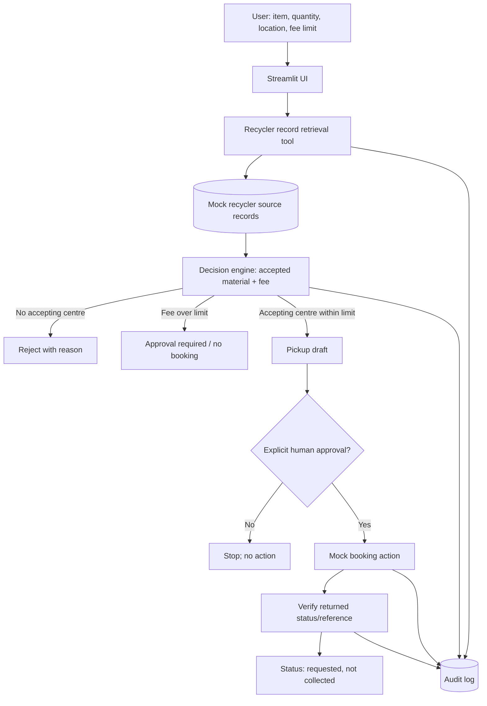

# Agent Architecture

## Tools and boundaries
- **Retrieval tool:** loads recycler records and displays source IDs, URLs and retrieval timestamps.
- **Decision tool:** checks material acceptance and computes `base_fee + per_item_fee × quantity`.
- **Approval gate:** explicit user approval is required before mock booking.
- **Action tool:** creates a mock reference, not an external booking.
- **Verification:** checks the action result separately; `requested` is not equivalent to `collected`.
- **Audit log:** records inputs, plan and action outcomes for review.

## Current limitations
This starter prototype uses deterministic matching and synthetic data; it does not yet retrieve the organizer's live/mock website or call an LLM. For the hackathon submission, be transparent about this. If time permits, connect the supplied mock recycler site as the retrieval source and show its evidence in the UI.
